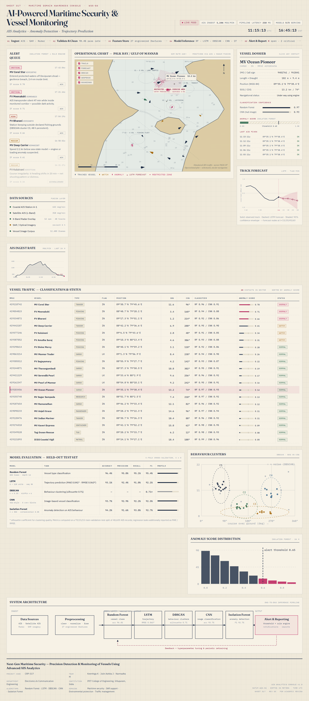

# AI-Powered Maritime Security & Vessel Monitoring

**AIS Analytics · Anomaly Detection · Trajectory Prediction** — Operational Dashboard (CRP-317)



## Overview

Maritime security faces persistent threats — illegal fishing, smuggling, piracy and unauthorized vessel movements. Traditional vessel monitoring often fails to detect unusual activity early or predict where a vessel is heading.

This project implements an AI-powered maritime security and vessel monitoring system built on **Automatic Identification System (AIS)** data analytics, machine learning and deep learning. It ingests vessel identification, position, speed and course data; preprocesses and engineers features; runs five models in parallel; and presents vessel traffic, detected anomalies and forecasts through a monitoring dashboard with rule-based alerting for maritime authorities.

## The Dashboard

A professional maritime domain-awareness console styled as a digital Admiralty chart table, implemented in pure HTML/CSS/JavaScript (no frameworks, no build step).

**Sections**

| Section | What it shows |
|---|---|
| Operational chart | Live vessel contacts with tracks, LSTM forecast path + confidence envelope, DBSCAN cluster hulls, geofenced restricted zone, soundings, graticule |
| Alert queue | Isolation Forest + rule-engine alerts (route deviation, AIS signal gap, loitering, speed anomaly) with severity + ACK workflow |
| Vessel dossier | Identity, classification confidence (Random Forest / CNN), anomaly score gauge vs 0.65 threshold, last AIS fixes |
| Vessel traffic table | All contacts: MMSI, type, position, SOG/COG, classifier output, anomaly score, status |
| Model evaluation | Held-out test-set metrics for all five models |
| Analytics | LSTM track forecast, DBSCAN SOG/COG clustering, anomaly-score distribution, 24 h AIS ingest rate |
| System architecture | End-to-end pipeline diagram incl. retraining feedback loop |

## Models

| Model | Task | Reported metric |
|---|---|---|
| Random Forest | Vessel type classification | Accuracy 96.4% |
| LSTM (2×128 units) | Trajectory prediction | MAE 0.041° / RMSE 0.063° |
| DBSCAN (ε=0.35, minPts=6) | Behaviour clustering | Silhouette 0.71 |
| CNN (5 conv blocks) | Image-based vessel classification | Accuracy 93.7% |
| Isolation Forest (n=300) | Anomaly detection on AIS behaviour | F1 92.7% |

> **Note on data:** vessel traffic, alert events and metric values shown in the dashboard are simulated demo content. Replace `maritime-dashboard/` values with your experimental results and live AIS feed before production use.

## Getting started

```bash
# option 1 — just open it
open index.html            # macOS
xdg-open index.html        # Linux

# option 2 — serve it
python3 -m http.server 8000
# → http://localhost:8000
```

No dependencies, no build step, works offline (Google Fonts load when online, with local fallbacks).

## Deployment (GitHub Pages)

The repository ships with `.github/workflows/deploy.yml`, which deploys automatically on every push to `main`:

1. Push to GitHub.
2. Repository **Settings → Pages → Source**: select **GitHub Actions**.
3. The dashboard goes live at `https://<user>.github.io/<repo>/`.

## Project structure

```
├── index.html                 # dashboard structure
├── styles.css                 # chart-table design system
├── app.js                     # AIS simulation, canvas chart, analytics
├── assets/dashboard-preview.png
└── .github/workflows/deploy.yml
```

## Project details

- **Project code:** CRP-317
- **Team:** Keerthiga K · Jolin Ashika J · Narmadha M
- **Department:** Electronics & Communication Engineering
- **Institution:** IFET College of Engineering, Villupuram, India

## Domains supported

Maritime security · Search & rescue support · Environmental protection · Maritime traffic management · Anti-trafficking operations
